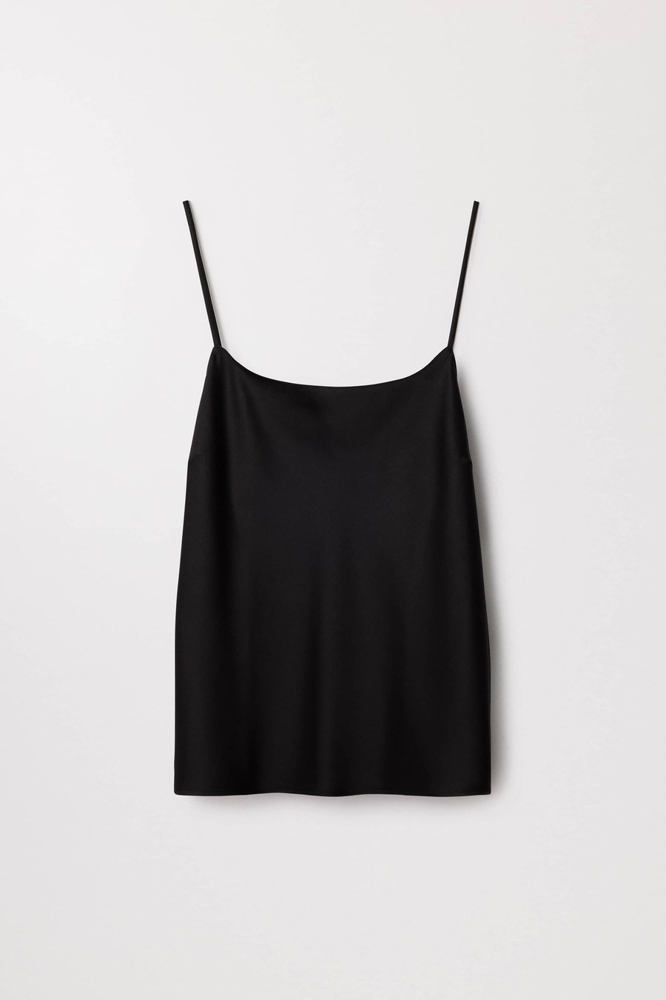
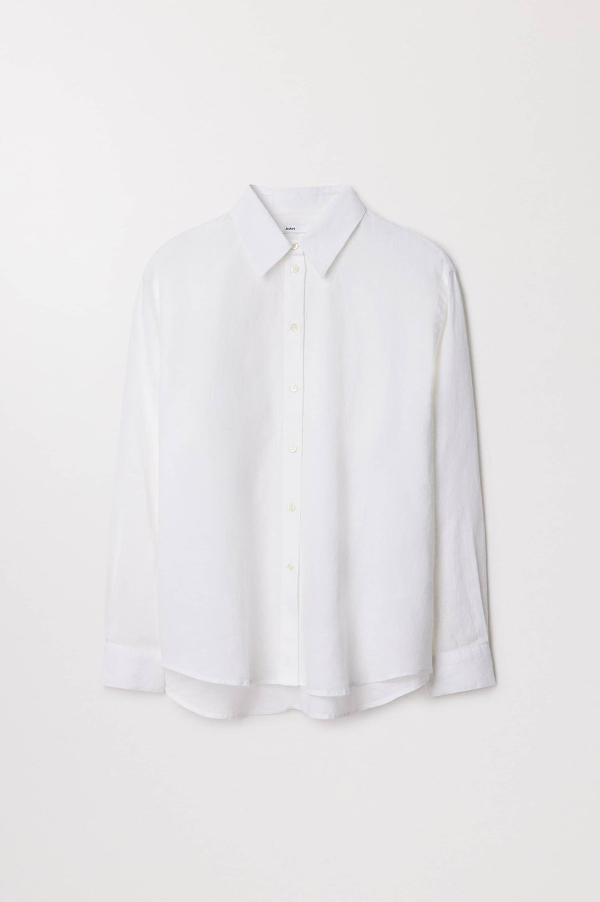
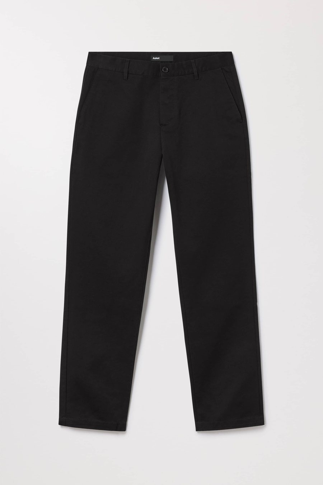
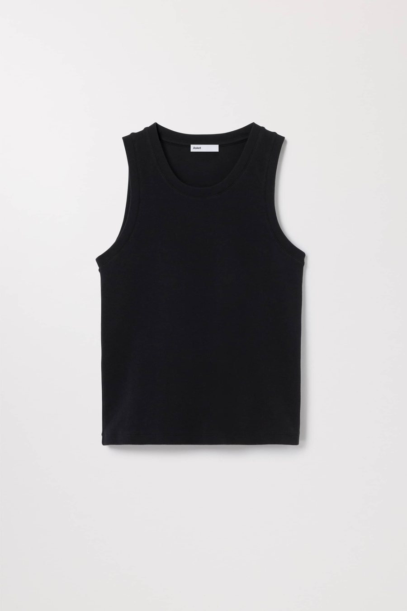

<p align="center">
  
</p>

<h1 align="center">FABRICLAB</h1>

<p align="center">An apparel store built around fabric, fit, and craft</p>

<p align="center">
  <a href="README.md">Chinese edition</a>
  · <a href="#overview">Overview</a>
  · <a href="#brand">Brand</a>
  · <a href="#features">Features</a>
  · <a href="#architecture">Architecture</a>
  · <a href="#quickstart">Quick start</a>
  · <a href="#verification">Verification</a>
</p>

---

<a id="overview"></a>

## At a glance

FABRICLAB is the complete implementation of a university course project. It is not a themed template: while keeping the seven business tables required by the course, the whole domain is rebuilt as an apparel brand. Five series lines, two product tracks, and verifiable fabric and craft records are first-class data, not decoration.

- **Two independent applications**: storefront on `8080`, admin on `8081`; separate startup, login, and sessions over one shared MySQL database.
- **Server-side rendering**: Spring MVC, Thymeleaf, and MyBatis-Plus; no front-end build step, shareable URLs, and fresh data on refresh.
- **A complete trading path**: persistent cart, checkout snapshot, five-state orders, teaching-only mock payment, and stock restoration on cancellation.
- **Brand as function**: style numbers (`FL-xxx`), fiber content, fabric weight, fit, and stitching craft live inside the product archive. Series, fabric, and craft pages grow from the same on-sale data.
- **Traceable delivery**: one branch and one merge request per module; the final version is pinned to an explicit commit on `main`. No fabricated history.

> Database, table, and column names plus requirement IDs from the course materials remain as necessary technical identifiers. Everything visible — interface, copy, imagery, sample data, and comments — uses apparel semantics.

<a id="brand"></a>

## Brand language

The mark is built from two interlocking pattern pieces. The negative space reads as both a seam line and the first cut laid out on undyed cloth. Three colors keep it restrained and legible across screen, tag, and packaging.

<table>
  <tr>
    <td bgcolor="#1A1A1A" width="72" height="30"></td>
    <td bgcolor="#F2EFE9" width="72" height="30"></td>
    <td bgcolor="#B4643A" width="72" height="30"></td>
  </tr>
  <tr>
    <td align="center">Ink<br><code>#1A1A1A</code></td>
    <td align="center">Ecru<br><code>#F2EFE9</code></td>
    <td align="center">Clay<br><code>#B4643A</code></td>
  </tr>
</table>

| Commute | Leisure | Outdoor | Occasion |
|---|---|---|---|
| <br>Commute garment | <br>Leisure shirt | <br>Outdoor trousers | <br>Home layer |

Product photography is real apparel and fabric imagery sourced from public web pages, not AI-generated. Per-image sources and licenses are recorded in [`fabriclab/store/src/main/resources/db/README.md`](fabriclab/store/src/main/resources/db/README.md). The mark is an original design.

<a id="features"></a>

## Feature map

### Storefront · `8080`

| Area | Entry | What it does |
|---|---|---|
| Browse | `/main`, `/category`, `/series/{id}` | Five series, two-level categories, name search, four sort orders, pagination; the product grid scrolls independently and filters locally after a 420 ms pause |
| Product archive | `/product?id=`, `/fabrics`, `/crafts` | Single-SKU style numbers, fiber / weight / fit / craft records, ordered albums with cover fallback; fabrics grouped by fiber, craft page with a right-edge rail |
| Accounts | `/register`, `/signon` | One-time server-side captcha, BCrypt, uniform failure messages, session identifier rotation, allowlisted return paths |
| Cart | `/cart` | Persisted in the database, not the session; same-item merging, 1–99 range, version and ownership checks, invalid items block checkout |
| Checkout and orders | `/checkout`, `/orders`, `/orders/{id}` | Server-side snapshot checks, price calculated on the server, five-state filters, conditional cancellation with exactly-one stock restoration |
| Mock payment | `/orders/{id}/payment` | Amount read only from `sales_order.total_amount`; failures write nothing, repeated success keeps the first receipt |
| Customer service | `/service` | Single-page workspace: guests see FAQs, members start or follow up on threads; `OPEN → REPLIED → CLOSED`, with reopen |

### Admin · `8081`

| Area | Entry | What it does |
|---|---|---|
| Categories and products | `/admin/categories`, `/admin/products` | Two-level category rules, unique style numbers, listing controls, search, bulk actions |
| Albums and restocking | `/admin/albums`, `/admin/products/{id}/restock` | Flat / on-body / detail sets, cover selection advances version; incremental restock against the latest stock with conflict retry |
| Customer accounts | `/admin/users`, `/admin/users/{id}` | Customer-only scope, profile edits, separate password reset and status toggle; role or status changes invalidate live sessions |
| Orders | `/admin/orders`, `/admin/orders/{orderNo}` | Exact order-number lookup, five state tabs, transaction snapshots, delivery edits, conditional shipping, restricted deletion |
| Service desk | `/admin/service` | List, search, detail, reply, close, and reopen for pre-purchase questions |
| Language | Chinese / English | UI copy in `messages*.properties`, product translations in a content dictionary; the two locales stay separate |

The admin console shows no order counts, revenue, or conversion figures that are not actually measured. Customer service covers pre-purchase questions only — no refunds, after-sales tickets, or delivery tracking.

<a id="architecture"></a>

## Architecture and constraints

```text
Browser 8080 ── store Spring Boot ──┐
                                    ├── MySQL 8.4 · MyPetStore
Browser 8081 ── admin Spring Boot ──┘
                7 course tables + 2 service extension tables
```

| Item | Version / convention |
|---|---|
| JDK | 25 (source level and bytecode) |
| Maven | 3.9.16 |
| Spring Boot | 3.5.16 |
| MyBatis-Plus | 3.5.18 |
| MySQL | 8.4, `utf8mb4`, `Asia/Shanghai` |
| Sessions | `STORESESSION` / `ADMINSESSION`, cookie-only, 30 minutes |
| Security | CSRF on every POST; protected routes recheck role and status on each request |
| Money | `BigDecimal`, two decimal places in CNY; order items keep transaction snapshots |
| Browsers | Desktop Chrome and Edge, walked through at 1366×768 and 1920×1080 |

Deliberate choices:

- **Single SKU**: no size or color columns; variants live in product names and descriptions, and style numbers never change.
- **Single pricing source**: payment reads only `sales_order.total_amount`; request parameters cannot affect price.
- **Conditional updates instead of row locks**: payment and cancellation are mutually exclusive via `id + status`; restocking uses `stock + version` to avoid overwriting.
- **Empty-in-production fault points**: `CheckoutFaultPoint` and `CancelFaultPoint` exist only as acceptance hooks.
- **Versioned static assets**: browsers revalidate styles immediately, so templates and CSS never drift apart.

<a id="quickstart"></a>

## Quick start

### 1. Prepare the database

Run these against an empty database in order. The first file is the only schema script; the app never creates or clears tables at startup.

```bash
mysql -u root -p < 01-schema.sql
mysql -u root -p < fabriclab/store/src/main/resources/db/seed-data.sql
mysql -u root -p < fabriclab/store/src/main/resources/db/customer-service.sql
```

The third step is optional: without it the service page is unavailable, while everything else still works. That script is idempotent by thread ID and message body.

### 2. Provide connection settings

```bash
export MYSQL_USER=root
export MYSQL_PASSWORD='<local MySQL password>'
```

### 3. Start both applications

In two terminals:

```bash
cd fabriclab/store && mvn spring-boot:run
cd fabriclab/admin && mvn spring-boot:run
```

| URL | Purpose |
|---|---|
| `http://localhost:8080/main` | Storefront home |
| `http://localhost:8081/admin` | Admin entry, redirects to sign-on when logged out |

Demo password: `Passw0rd!2026` (for local teaching only). Accounts: `alice` and `bob` are customers, `disabled` is a blocked example, and `admin` is the administrator.

### 4. Run the tests

```bash
cd fabriclab/store && mvn test
cd fabriclab/admin && mvn test
```

> **Test isolation**: Surefire pins the test database to `mypetstoretest` in both projects. Never point tests at the demo database `MyPetStore` — integration tests clear and rebuild orders, carts, and other fixtures.

<a id="verification"></a>

## Verification

| Item | Result |
|---|---|
| Storefront automated tests | 284 passing |
| Admin automated tests | 138 passing |
| End-to-end browser walkthrough | 50 / 50 passing, zero JS errors, zero 4xx / 5xx |
| Live database acceptance | AC-01 to AC-32 mapped to V01 to V18 with records |
| Concurrency | AC-28 purchase and restock verified with two running applications |

The browser walkthrough covers a full purchase, payment, cancellation, service handoff, admin product / user / order / service flows, language switching, registration, and access protection. AC-16 and AC-23 are reproduced only through their dedicated fault-injection points.

## Layout

| Path | Contents |
|---|---|
| `fabriclab/store/` | Storefront application, templates, styles, images, tests |
| `fabriclab/admin/` | Admin application, bilingual copy, tests |
| `fabriclab/docs/` | Admin design, admin visual specification, service design |
| `01-schema.sql` | Only schema script from the course |
| `02-schema-with-demo.sql` | Course comparison script, not executed |
| `MyPetStore-PRD.pdf` | Course requirement specification |
| Course UI reference folder | Original course mockups, used only where needed |
| `.build/` | Local walkthrough and tooling scripts, not product code |

Course handouts with Chinese filenames remain in the repository root. All code lives under `fabriclab/`; the IntelliJ project root is `fabriclab/`, with shared configuration in `fabriclab/.idea/`.

## Further reading

- [Storefront notes](fabriclab/store/README.md)
- [Admin notes](fabriclab/admin/README.md)
- [Database and seed data](fabriclab/store/src/main/resources/db/README.md)
- [Admin design](fabriclab/docs/admin-design.md)
- [Service design](fabriclab/docs/service-design.md)

---

<p align="center">FABRICLAB · Fabric with a record, fit with intent, craft with a name.</p>
