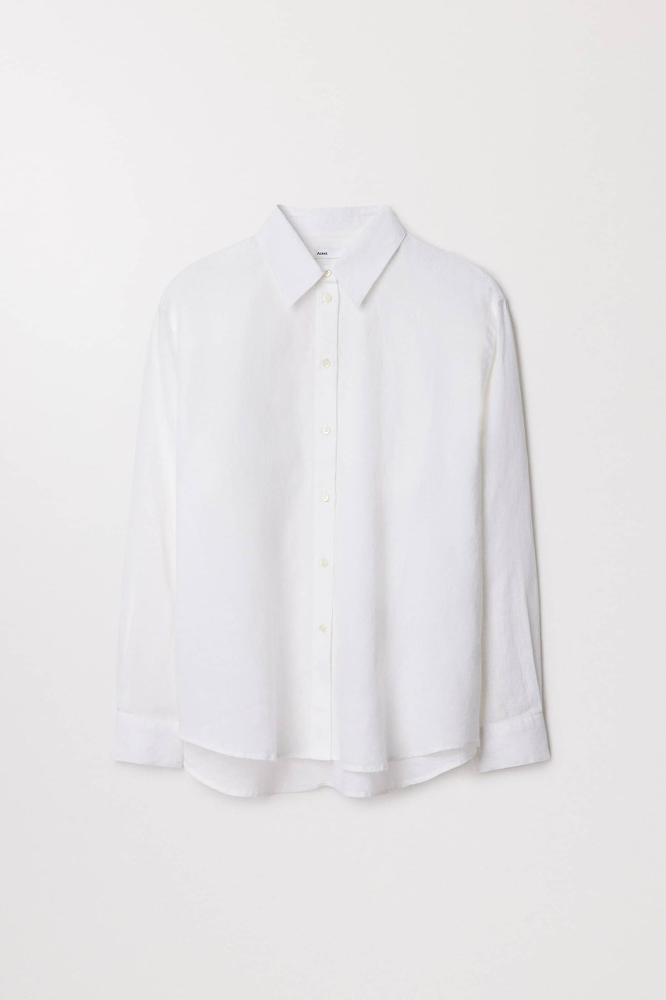
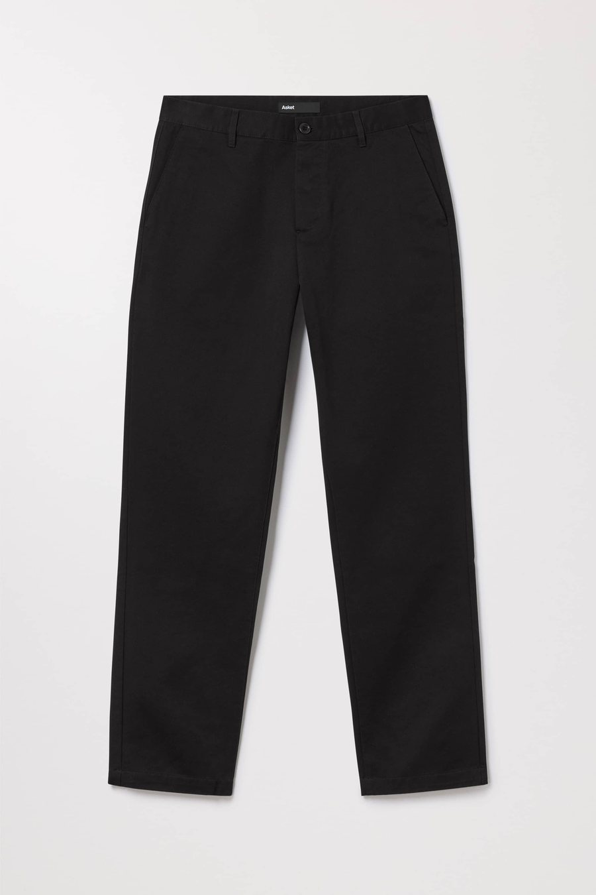
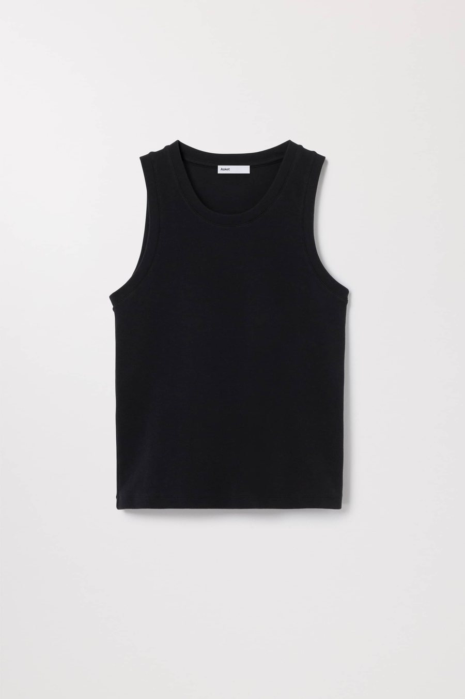

<p align="center">
  
</p>

<h1 align="center">FABRICLAB · 未染</h1>

<p align="center">以面料、版型与工艺为商品语言的服装商城</p>

<p align="center">
  <a href="README.en.md">English</a>
  · <a href="#overview">概览</a>
  · <a href="#brand">品牌</a>
  · <a href="#features">功能</a>
  · <a href="#architecture">架构</a>
  · <a href="#quickstart">快速开始</a>
  · <a href="#verification">验证</a>
</p>

---

<a id="overview"></a>

## 一眼看懂

FABRICLAB 是《软件开发架构平台》实验一的完整实现。它不是把课程示例换一层皮：在保留课程七张业务表契约的前提下，整个业务语义重建为服装品牌「未染」——五条系列线、成衣与配饰两条品类支线、可查验的面料档案与工艺说明。

- **两套独立应用**：用户端 `8080`、管理端 `8081`，独立启动、独立登录、独立会话，共享同一 MySQL 库。
- **服务器端渲染**：Spring MVC + Thymeleaf + MyBatis-Plus，无前端构建链；页面直出，链接可分享，刷新即取最新数据。
- **真实交易链路**：持久购物车、结算快照、订单五态、教学模拟支付、取消回补库存，全部落库并带并发条件。
- **品牌即功能**：款号 `FL-xxx`、面料成分、克重、版型、缝制工艺写进商品档案；系列专题、面料档案、工艺页不是装饰页，而是从同一份在售数据长出来的。
- **可追溯交付**：按模块建分支、提交合并请求，最终版本由 `main` 的明确提交定位；不补造历史。

> 课程材料中的库名、表名、字段名与需求编号作为必要技术标识保留；界面、文案、图片、示例数据、注释一律使用服装语义。

<a id="brand"></a>

## 品牌语言

标志取自「交织裁片」：两枚裁片互相咬合，留白是缝线，也是未染布面上最先落下的版型线。整体只用三色，克制、可辨识，且能直接落到网页、吊牌与包装上。

<table>
  <tr>
    <td bgcolor="#1A1A1A" width="72" height="30"></td>
    <td bgcolor="#F2EFE9" width="72" height="30"></td>
    <td bgcolor="#B4643A" width="72" height="30"></td>
  </tr>
  <tr>
    <td align="center">墨黑<br><code>#1A1A1A</code></td>
    <td align="center">米白<br><code>#F2EFE9</code></td>
    <td align="center">陶土<br><code>#B4643A</code></td>
  </tr>
</table>

| 通勤出行 | 休闲生活 | 户外运动 | 居家舒适 |
|---|---|---|---|
| <br>通勤成衣 | <br>休闲服饰 | <br>户外服饰 | <br>居家服装 |

商品图为公开网页的真实服装 / 面料摄影，非 AI 生成；来源与许可逐图记录在 [`fabriclab/store/src/main/resources/db/README.md`](fabriclab/store/src/main/resources/db/README.md)。标志为自有设计。

<a id="features"></a>

## 功能版图

### 用户端 · `8080`

| 模块 | 入口 | 做了什么 |
|---|---|---|
| 选购 | `/main`、`/category`、`/series/{id}` | 五条系列线、两级分类、名称搜索、四种排序、分页；商品网格独立滚动，输入停 420ms 局部筛选 |
| 商品档案 | `/product?id=`、`/fabrics`、`/crafts` | 单 SKU 款号、面料 / 克重 / 版型 / 工艺、按序相册与封面回退；面料按纤维归组，工艺页右缘侧轨 |
| 账户 | `/register`、`/signon` | 服务端验证码一次性消费、BCrypt、统一失败提示、登录换会话标识、站内返回页白名单 |
| 购物车 | `/cart` | 存库不存 Session；同款累加、1—99 限域、版本与归属校验、失效条目阻止结算 |
| 结算与订单 | `/checkout`、`/orders`、`/orders/{id}` | 服务端快照核对、金额后端计算、五状态筛选、取消带原状态条件且只回补一次库存 |
| 模拟支付 | `/orders/{id}/payment` | 金额只取订单 `total_amount`；失败不写库，重复成功保留首次凭证 |
| 客服 | `/service` | 单页工作台：游客看 FAQ，会员发起 / 追问 / 查看对话；状态 `OPEN → REPLIED → CLOSED`，可重开 |

### 管理端 · `8081`

| 模块 | 入口 | 做了什么 |
|---|---|---|
| 分类与商品 | `/admin/categories`、`/admin/products` | 两级分类约束、款号唯一、上下架、搜索筛选、批量操作 |
| 相册与补货 | `/admin/albums`、`/admin/products/{id}/restock` | 平铺 / 上身 / 细节三组、设封面推版本；补货按最新库存增量更新，冲突提示重试 |
| 顾客账号 | `/admin/users`、`/admin/users/{id}` | 仅顾客账号、资料维护、独立重置口令与启停；改角色 / 停用即时失效在线会话 |
| 订单管理 | `/admin/orders`、`/admin/orders/{orderNo}` | 订单号精确查、五状态分段、成交快照、改收货、发货条件更新、受限删除 |
| 客服工作台 | `/admin/service` | 列表 / 搜索 / 详情 / 回复 / 关闭 / 重开，售前咨询单线程闭环 |
| 语言 | 中 / 英切换 | 界面文案走 `messages*.properties`，商品内容走英译词典；两端不串味 |

管理端控制台不展示订单量、销售额、转化率等未经真实统计的指标。客服是售前选购咨询，不处理退款、售后工单或物流轨迹。

<a id="architecture"></a>

## 架构与约束

```text
浏览器 8080 ── 用户端 Spring Boot ──┐
                                    ├── MySQL 8.4 · MyPetStore
浏览器 8081 ── 管理端 Spring Boot ──┘
                7 张课程业务表 + 2 张客服扩展表
```

| 项 | 版本 / 约定 |
|---|---|
| JDK | 25（语言级别与字节码均为 25） |
| Maven | 3.9.16 |
| Spring Boot | 3.5.16 |
| MyBatis-Plus | 3.5.18 |
| MySQL | 8.4，`utf8mb4`，`Asia/Shanghai` |
| 会话 | `STORESESSION` / `ADMINSESSION`，仅 Cookie 传递，30 分钟 |
| 安全 | 全部 POST 校验 CSRF；受保护入口每次请求复核角色与启用状态 |
| 金额 | `BigDecimal`，人民币两位小数；订单明细保存成交快照 |
| 浏览器 | 桌面 Chrome / Edge，按 1366×768 与 1920×1080 走查 |

几个刻意的设计：

- **单 SKU 口径**：不设尺码 / 配色字段，差异写进名称与描述；款号创建后不可变。
- **计价唯一来源**：支付只读 `sales_order.total_amount`，请求参数不参与定价。
- **条件更新代替锁行**：支付与取消靠 `id + status` 条件更新互斥；补货靠 `stock + version` 条件更新防覆盖。
- **故障注入点生产为空**：`CheckoutFaultPoint` / `CancelFaultPoint` 仅在验收时定位，不影响正常使用。
- **静态资源版本参数**：样式改动后浏览器立即重验，避免新旧模板与旧缓存错配。

<a id="quickstart"></a>

## 快速开始

### 1. 准备数据库

空库按顺序执行，第一部分是课程唯一建表脚本，应用启动不建表、不清库：

```bash
mysql -u root -p < 01-schema.sql
mysql -u root -p < fabriclab/store/src/main/resources/db/seed-data.sql
mysql -u root -p < fabriclab/store/src/main/resources/db/customer-service.sql
```

第三步是可选扩展；不导入时客服页不可用，其余功能不受影响。客服脚本按编号与正文判重，可重复执行。

### 2. 提供连接参数

```bash
export MYSQL_USER=root
export MYSQL_PASSWORD='<本机 MySQL 口令>'
```

### 3. 启动两端

在两个终端分别执行：

```bash
cd fabriclab/store && mvn spring-boot:run
cd fabriclab/admin && mvn spring-boot:run
```

| 地址 | 用途 |
|---|---|
| `http://localhost:8080/main` | 用户端首页 |
| `http://localhost:8081/admin` | 管理端入口，未登录跳登录页 |

演示口令 `Passw0rd!2026`（仅本地教学用）。账号：`alice` / `bob` 为顾客，`disabled` 为禁用样例，`admin` 为管理员。

### 4. 跑测试

```bash
cd fabriclab/store && mvn test
cd fabriclab/admin && mvn test
```

> **测试隔离**：两个工程的 surefire 已把测试库固定为 `mypetstoretest`。严禁把测试指向演示库 `MyPetStore`——集成测试会清空并重建订单、购物车等 fixture。

<a id="verification"></a>

## 验证情况

| 项 | 结果 |
|---|---|
| 用户端自动化测试 | 284 项通过 |
| 管理端自动化测试 | 138 项通过 |
| 端到端真实操作走查 | 50 / 50 通过，零 JS 错误、零 4xx / 5xx |
| 真库验收 | AC-01 ~ AC-32 与 V01 ~ V18 对应记录齐备 |
| 并发场景 | AC-28 购买与补货由两个实际运行的应用验证 |

端到端走查覆盖完整购物、支付、取消、客服联动、后台商品 / 用户 / 订单 / 客服、中英切换、注册与权限保护。AC-16 与 AC-23 只通过各自唯一故障注入点复现。

## 目录

| 路径 | 内容 |
|---|---|
| `fabriclab/store/` | 用户端工程、模板、样式、图片、测试 |
| `fabriclab/admin/` | 管理端工程、双语文案、后台测试 |
| `fabriclab/docs/` | 后台设计、后台视觉规范、客服设计 |
| `01-schema.sql` | 课程唯一建表脚本 |
| `02-schema-with-demo.sql` | 课程对照脚本，不执行 |
| `实验一实施方案.md` | 任务分解、分支节奏与交付清单 |
| `MyPetStore-PRD.pdf` | 课程需求规约 |
| `《软件开发架构平台》实验指导书2025级_实验一.doc` | 课程实验指导书 |
| `MyPetstore用户端参考UI/` | 课程界面参考，仅作必要参考 |
| `.build/` | 本机走查与工具脚本，不属于产品代码 |

工程代码只放在 `fabriclab/` 内；IntelliJ IDEA 项目根为 `fabriclab/`，配置位于 `fabriclab/.idea/`。

## 延伸阅读

- [用户端工程说明](fabriclab/store/README.md)
- [管理端工程说明](fabriclab/admin/README.md)
- [数据库与种子数据](fabriclab/store/src/main/resources/db/README.md)
- [后台设计](fabriclab/docs/admin-design.md)
- [客服设计](fabriclab/docs/service-design.md)
- [实验实施方案](实验一实施方案.md)

---

<p align="center">FABRICLAB · 未染 · 面料有据，版型有型，工艺可循</p>
